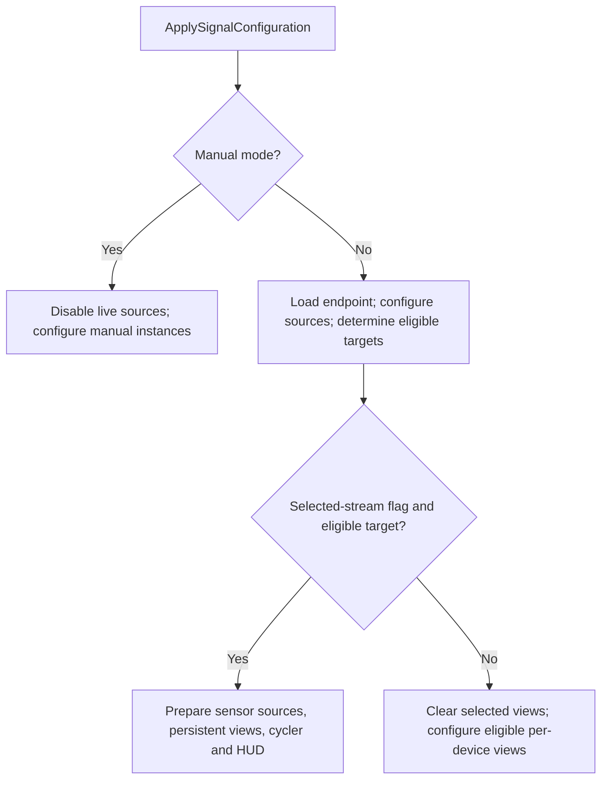

# Bootstrapper execution paths: refactor step 1

Reviewed on 2 November 2026, branch `cleanup/obsolete-code`, source commit `4969cf919b7ae4a28925c6ad9663c51a6b49e966`. Scope: document the existing supported paths and their dependencies before refactoring. No mode retirement, source edit, field/method removal, scene migration, or package change is part of this step.

Source: [Bootstrapper.cs](../../../Assets/AmpPortableDataViz/Presentation/Bootstrap/Bootstrapper.cs), 1,998 lines. [method-field-map.json](method-field-map.json) lists all 59 method declarations and 62 top-level public configuration fields, with source lines, local method mentions, and field mentions. All 62 fields have direct method references; this is lexical evidence, not a claim that each runs in the default scene. Nested runtime records are mapped below separately.

## Supported paths and entry points

Retain the following paths through the refactor. Manual, Sine/session fallback, and per-device modes remain supported even though the saved app uses selected-sensor Redis mode. Removing any of those modes requires a separate decision.

| Path | Selection / entry | Main methods and outcome |
| --- | --- | --- |
| Shared initialization | Unity `Awake` then `OnEnable` | `Awake` initializes endpoint readiness, calls `EnsureAnchorRegistry`, `EnsureSources`, `EnsureVisualPrefab`, and `ApplySignalConfiguration`, then constructs clock, anchor/network services, factory, mapper, and session controller. `OnEnable` chooses discovery or configuration followed by `BeginSessionIfReady`. Shared setup still occurs in modes that bypass the session controller. |
| Endpoint confirmation and discovery | Scene UnityEvent calls public `BeginAfterEndpoint`; `OnEnable` also evaluates discovery | `BeginAfterEndpoint` reloads host/port from `RedisRuntimeSettings`, marks readiness, stops tracked initialization/discovery coroutines, then chooses discovery or configuration. `ShouldAutoDetectEmotionDeviceIds` requires non-manual Redis mode, discovery and configured-channel flags, a host, and confirmation when required. `StartDeviceDiscovery` / `DiscoverEmotionDevicesThenApply` wait for Redis discovery, update IDs only after a successful nonempty result, then apply configuration and consider session startup. Fault/cancellation does not erase configured IDs. |
| Selected-sensor Redis views | Redis selected, usable host, endpoint ready, `UseSingleSelectedSensorStream`, and at least one eligible auto-spawn target | `ApplySignalConfiguration` builds/filters sensor definitions and prepares engagement; `EnsureSelectedSensorStreamMode` creates one source binding per usable sensor and one persistent particle, graph, and/or artist target. `EnsureSensorStreamPresentation` wires `SensorStreamCoordinator`, `RayNeoTempleSensorStreamCycler`, and the current HUD. Target creation uses `SpawnSelectedSensorVisual`; cleanup uses `ClearSelectedSensorStreamMode`. |
| Per-device Redis views | Eligible Redis particle/graph targets, with selected-stream mode disabled | `EnsureAudienceDeviceVisuals` and `EnsureAudienceGraphDeviceVisuals` create per-device instances, acquire shared physio pumps, and configure live bindings. Layout/labels use `PositionEmotionVisual`, `PositionGraphGroup`, `AttachDeviceLabel`, and `AttachGraphGroupLabel`. Their matching clear methods release instances and pump references. Artist auto-spawning currently requires selected-stream mode and does not participate in this per-device path. |
| Manual development mode | `UseManualVisualizationDrivers = true`; first branch in `ApplySignalConfiguration` | `ApplyManualDriverConfiguration` disables Sine/primary Redis sources and clears automatic view/engagement state. `EnsureManualDriverVisuals` uses `SpawnManualDriverPrefab` and `ConfigureManualDriverInstance` for configured visual/graph templates with a supported manual driver. Audience manual drivers take precedence over particle/graph manual drivers. No confirmed endpoint is required for this path. `ShouldInitializeSessionController` returns false. |
| Sine/session fallback | Manual mode off and `ShouldInitializeSessionController` permits it | `BeginSessionIfReady` starts `BeginSession`, which configures `VisualizationSessionOptions`, initializes the session, and binds the selected source. `EnsureSources` finds a Sine source and creates one for a host if needed; `EnsureVisualPrefab` creates a sphere with `SimpleVisualizer` and `AnchoredVisualization` if the configured prefab is absent. The Redis primary-source fallback is eligible when both audience/graph auto-spawn flags are off; it requires a found/assigned enabled `RedisDataPump`. |

`ApplySignalConfiguration` dispatches the visual modes as follows. Endpoint/discovery is an earlier concern; the diagram describes the configuration call itself.

Session-controller startup is evaluated separately by `BeginSessionIfReady` after relevant entry points. Its existing predicate uses mode flags, not a full validation of the configured prefabs: it skips manual mode and Redis with either audience or graph auto-spawn enabled. It permits Sine mode and Redis with those two flags disabled. Do not conflate this predicate with the visual-mode diagram.

## Saved application configuration

`ProjectSettings/EditorBuildSettings.asset` enables only [ampPortable_xrGlassesDemo.unity](../../../Assets/Scenes/ampPortable_xrGlassesDemo.unity). The saved Bootstrapper has:

| Setting | Saved value / meaning |
| --- | --- |
| `ActiveSignalSource` | `1` (`Redis`); keep enum values `Sine = 0`, `Redis = 1` stable. |
| `UseManualVisualizationDrivers` | `0`. |
| `RequireRedisEndpointConfirmation` | `1`. |
| `IncludeEmotionChannels`, `AutoDetectEmotionDeviceIds` | Both `1`; saved device-ID list is empty, so discovery supplies IDs at runtime when successful. |
| `UseSingleSelectedSensorStream` | `1`. |
| Audience, graph, and artist auto-spawn flags | All `1`. |
| `UseIndividualSensorEngagement` | `1`; per-sensor channel template and neutral/timeout settings are serialized. |
| `VisualPrefab` | `ParticleMeshVizRoot_RayNeo`, inheriting the retained particle prefab chain. |
| `GraphPrefab`, `ArtistVizPrefab` | `AudienceGraphPrefab` and `ArtistViz`. |
| `AnchorRegistry`, `SineSource`, `RedisSource` | Null in the saved scene; corresponding lookup/creation/fallback code must not be classified as dead solely from those null values. |

The endpoint prompt's persistent call targets Bootstrapper fileID `1639454965` and `BeginAfterEndpoint` (scene lines 458-461). Preserve that public method and its serialized target during extraction. Unity also invokes `Awake`, `OnEnable`, `OnDisable`, `OnDestroy`, and Editor `OnValidate`; they need no ordinary C# caller. `OnValidate` reapplies configuration only while the Editor is playing.

The score/image board and four-root visualization toggle are retained scene/prefab responsibilities outside Bootstrapper's creation methods. The refactor must preserve their wiring as well as the dynamic particle/graph/artist targets.

## Configuration ownership

These are current responsibilities and proposed preservation boundaries, not authorization to move fields or alter serialization. Exact per-method references are in the JSON map.

| Responsibility | Required configuration fields |
| --- | --- |
| Mode/source selection and scene dependencies | `ActiveSignalSource`, `UseManualVisualizationDrivers`, `IsHost`, `AnchorRegistry`, `SineSource`, `RedisSource`. |
| Endpoint/discovery/channel definitions | `RedisHost`, `RedisPort`, `RedisChannel`, `RedisChannels`, `RequireRedisEndpointConfirmation`, `IncludeEmotionChannels`, `EmotionDeviceIds`, `AutoDetectEmotionDeviceIds`, `RedisDiscoveryTimeoutMs`. The older Emotion names currently govern audience/sensor configuration. |
| Particle/audience views, including manual placement | `VisualPrefab`, `AutoSpawnAudienceVisualsFromChannels`, `EmotionVisualParent`, `EmotionVisualOriginOffset`, `EmotionVisualSpacing`, `EmotionVisualsPerRow`. |
| Per-device particle labels | `ShowDeviceLabels`, `DeviceLabelOffset`, `DeviceLabelFontSize`, `DeviceLabelColor`. |
| Artist view | `AutoSpawnArtistVizFromChannels`, `ArtistVizPrefab`, `ArtistVizParent`. |
| Sensor engagement backend | `UseIndividualSensorEngagement`, `SensorEngagementChannelTemplate`, `SensorEngagementChannelOverrides`, `SensorEngagementTimeoutSeconds`, `SensorEngagementNeutralValue`, `SensorEngagementPayloadFormat`. |
| Selected-stream presentation and HUD | `UseSingleSelectedSensorStream`, `SensorHudCamera`, `SensorHudLocalPosition`, `SensorHudLocalScale`, `SensorHudFontSize`, `SensorHudColor`. |
| Current graphs and manual graph placement | `AutoSpawnGraphVisualsFromChannels`, `GraphPrefab`, `GraphGroupParent`, `GraphGroupOriginOffset`, `GraphGroupSpacing`, `GraphGroupsPerRow`. |
| Per-device graph labels and their bounds | `ShowGraphGroupLabels`, `GraphGroupLabelOffset`, `GraphGroupLabelVerticalOffset`, `GraphGroupLabelFontSize`, `GraphGroupLabelColor`, `GraphItemBoundsSize`, `GraphGroupBoundsPadding`. These bounds still affect label placement. |
| Generic session/fallback | `VisualId`, `ProfileId`, `Seed`, `AnchorLabel`, `AnchorPosition`, `AnchorRotationEuler`, `SpawnTopic`, `ParamTopic`, `MapperSettings`, plus the shared source/prefab/host/registry settings above. |

Changing public fields, names, or grouping into nested settings would be a later serialization/caller migration. Preserve saved prefab assignments, offsets, colors, sizes, event targets, and numeric source values in this step.

## Runtime ownership and teardown

| Owner/state | Creation/use | Release and preservation requirement |
| --- | --- | --- |
| Session/controller/mapper | Constructed in `Awake`; used by `BeginSession` and source binding. Anchor registry, MockAnchorService, LocalLoopbackNetworkSync, and UnityVisualizationFactory are real dependencies of the supported fallback path. | `OnDisable` calls controller `Shutdown`; `OnDestroy` calls `Dispose` and clears the controller reference. |
| `_initializationRoutine`, `_deviceDiscoveryRoutine`, `_redisEndpointReady` | Session/discovery entry points and endpoint-confirmation state. | Tracked coroutines stop on disable or endpoint reconfirmation. Stopping the discovery coroutine is not evidence that its underlying asynchronous Redis task was canceled. |
| `_sharedPhysioPumpsByChannel`, `SharedPhysioPumpHandle` | `AcquirePhysioPumpForChannel` shares by channel, maintains a reference count, and reconnects a reused pump when host/port changes. Handle stores channel/host/port/pump/count. | `ReleasePhysioPump` decrements and destroys/removes the handle at zero. A selected stream uses one pump per sensor; per-device particle and graph consumers can share a pump and must balance both releases. |
| `_selectedSensorSources`, `SelectedSensorSourceInstance` | Own each sensor's source object/binding and physio channel. | `ClearSelectedSensorStreamMode` first detaches coordinator bindings/sources, then destroys source objects, releases pumps, and clears the list. |
| `_selectedParticleVisual`, `_selectedGraphVisual`, `_selectedArtistVisual`, `_sensorHudObject` | Persistent target/HUD objects for the selected-stream mode. | Destroyed/cleared by selected-stream teardown. The coordinator/cycler component references themselves remain; this method does not remove those components. |
| `_audienceDeviceInstances`, `AudienceDeviceInstance` | Per-device particle/audience instance, binding, identity, channel, and pump bookkeeping. | `ClearAudienceDeviceVisuals` destroys each instance (or binding-object fallback), releases its channel, and clears the list. |
| `_audienceGraphDeviceGroups`, `AudienceGraphDeviceGroupInstance` | Per-device graph root, binding, identity/index, channel, and pump bookkeeping. | `ClearAudienceGraphDeviceVisuals` destroys roots (or binding-object fallback), releases channels, and clears the list. |
| Engagement backend object/pump/coordinator/configuration key | `EnsureSensorEngagementBackend` normalizes IDs, builds routes and decoder, and reuses an unchanged configuration. Empty routes or disabled individual engagement still create coordinator sources with neutral/freshness behavior for known sensors. | `ClearSensorEngagementBackend` destroys the backend root and clears references/key. Clear consumers before destroying shared sources. |
| `_manualDriverInstances` | Spawn/configure supported manual templates; an existing nonempty list avoids duplicate creation. | `ClearManualDriverVisuals` destroys instances and clears the list when leaving manual mode or tearing down. |

`OnDisable` stops tracked coroutines and shuts down the session, then clears per-device views, selected-stream state, engagement backend, and manual instances. `OnDestroy` disposes the controller and repeats object cleanup. `DisableRedisComponents` disables the primary Redis source and clears those runtime objects, without performing controller shutdown or stopping discovery itself. These differences and cleanup order must remain visible during any later consolidation.

## Existing behavior to characterize before changing it

These are observations to preserve or test in a future implementation step; nothing is fixed here.

- `Awake` applies configuration before constructing the session controller; `OnEnable` may apply it again or start discovery. Reconfiguration can destroy/recreate selected or per-device views. An extraction must not silently reorder initialization or assume every call is idempotent.
- In host Sine mode, `BeginSession` calls `BindSignalSource` before the source switch and again in its Sine branch. The session method adds a subscription on each call. Address duplicate subscription behavior in its own tested change, not while documenting modes.
- The fallback session predicate does not inspect endpoint readiness, actual target eligibility, or the artist-only auto-spawn case. A missing/invalid target does not itself cause this predicate to fall back to a session. Record these conditions instead of assuming all combinations of flags are validated configurations.
- The per-device path has particle/graph targets; ArtistViz auto-spawning belongs to the selected-stream path. Manual creation only considers the configured visual and graph prefabs.
- Missing/empty discovery results preserve configured IDs. A usable automatic sensor binding needs both a physio pump and an engagement source. The engagement-disabled/neutral path is distinct from removing the engagement coordinator entirely.
- The old Emotion-named settings still serve current layout/discovery. Graph bounds still serve labels. Shared source/session helpers and lifecycle methods remain reachable even when unused in the saved scene's particular mode.

## Baseline and later validation boundaries

Existing evidence at this source commit is in the [optional-feature retirement report](../../2026-10-30/cleanup-step5/README.md): final full PlayMode suite 193/193, Android build succeeded with zero errors and 20 existing warnings, enabled-scene inspection clear. Its earlier intermittent halo failure remains recorded. Those are historical results, not tests rerun for this documentation-only step.

Existing [BootstrapperArtistVizTests](../../../Assets/Tests/PlayMode/BootstrapperArtistVizTests.cs) exercise selected-artist spawn/registration/cleanup using reflected private methods. [BootstrapperRetainedGraphTests](../../../Assets/Tests/PlayMode/BootstrapperRetainedGraphTests.cs) exercise manual graph rendering, manual mode before endpoint confirmation, and selected graph wiring. Sensor-stream/engagement and interface tests cover their underlying helpers. This does not establish complete integration coverage of every mode/transition. Later changes need focused checks for endpoint reconfirmation, repeated enable/disable, balanced pump sharing/release, per-device layout/labels, neutral engagement, and fallback subscriptions.

Keep existing layer boundaries: Core contracts, Application session/data orchestration, Infra concrete services, and Presentation Unity creation/binding/layout. This map grants no dependency removal or additional feature retirement.

[verification.json](verification.json) records the unchanged source-input fingerprint and checks on this documentation. No Unity session, test run, Android build, or device action was started. Only this assessment directory was added. **Refactor step 2 has not started.**
